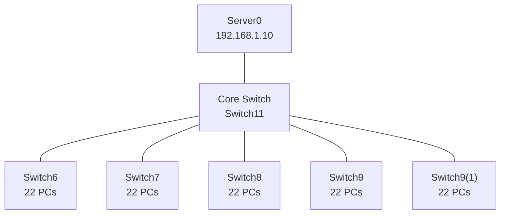
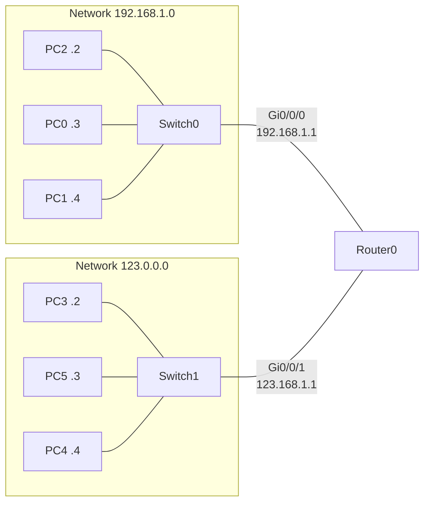
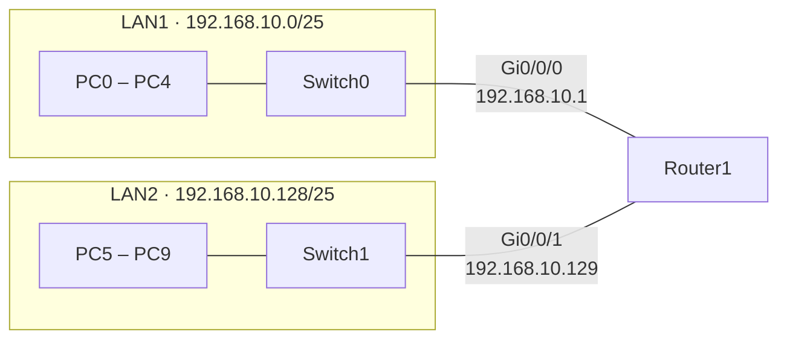
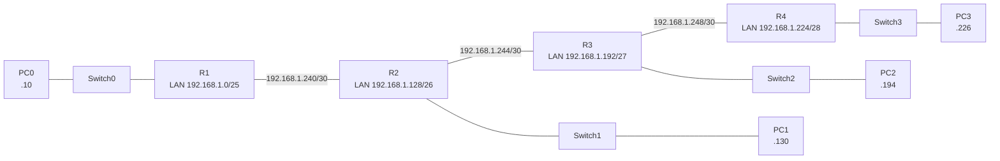

<div align="center">


**Hands-on Packet Tracer labs from my Computer Networks course: LAN design, router configuration, DHCP, fixed-length and variable-length subnetting, and static routing.**

[Labs](#labs-at-a-glance) • [Lab 2](#1-lab-2--lan-with-dhcp-server) • [Router Config](#2-router-configuration--two-networks) • [FLSM](#3-flsm--fixed-length-subnetting) • [VLSM](#4-vlsm--variable-length-subnetting) • [Getting Started](#getting-started)

</div>

---

## Labs at a Glance

| # | File | Topic | Devices | Key concepts |
|---|------|-------|---------|--------------|
| 1 | [`cn lab2.pkt`](cn%20lab2.pkt) | Large LAN with a DHCP server | 1 server, 6 switches, 110 PCs | Hierarchical switching, DHCP, server services |
| 2 | [`Router config.pkt`](Router%20config.pkt) | Router connecting two networks | 1 router, 2 switches, 6 PCs | Router interfaces, default gateways, inter-network routing |
| 3 | [`flsm.pkt`](flsm.pkt) | Fixed-length subnet masking | 1 router, 2 switches, 10 PCs | `/25` subnets, router-based DHCP pools, RIP |
| 4 | [`vlsm task.pkt`](vlsm%20task.pkt) | Variable-length subnet masking | 4 routers, 4 switches, 4 PCs | `/25` `/26` `/27` `/28` LANs, `/30` serial links, static routes |

All files were saved with **Cisco Packet Tracer 9.0**, so open them with 9.0 or later.

---

## 1. Lab 2 — LAN with DHCP Server

**Objective:** Build a large, hierarchical LAN where one server hands out addresses to every host and provides common network services.

### Topology



### Design

| Item | Value |
|------|-------|
| Hosts | 110 PCs, 22 per access switch |
| Switching | 5 access switches uplinked to 1 core switch |
| Server | `Server0`, static IP `192.168.1.10` |
| DHCP pool | `serverPool`, starts at `192.168.1.11`, up to 110 users |
| Client mode | All 110 PCs use DHCP |
| Cabling | Copper straight-through throughout |

### Server services enabled

`DHCP` • `HTTP` • `FTP` • `TFTP` • `NTP` • `Syslog`

### Verify

1. Open any PC → **Desktop → IP Configuration** → select **DHCP** and confirm an address from `192.168.1.11` onward.
2. From a PC, ping `192.168.1.10` to confirm reachability to the server.
3. Open the **Web Browser** on a PC and browse to `http://192.168.1.10`.

---

## 2. Router Configuration — Two Networks

**Objective:** Configure a router with two interfaces so hosts on two different networks can communicate.

### Topology



### Addressing

| Device | Interface | IP address | Mask | Gateway |
|--------|-----------|------------|------|---------|
| Router0 | Gi0/0/0 | 192.168.1.1 | 255.255.255.0 | n/a |
| Router0 | Gi0/0/1 | 123.168.1.1 | 255.0.0.0 | n/a |
| PC2 | NIC | 192.168.1.2 | | 192.168.1.1 |
| PC0 | NIC | 192.168.1.3 | | 192.168.1.1 |
| PC1 | NIC | 192.168.1.4 | | 192.168.1.1 |
| PC3 | NIC | 123.168.1.2 | | 123.168.1.1 |
| PC5 | NIC | 123.168.1.3 | | 123.168.1.1 |
| PC4 | NIC | 123.168.1.4 | | 123.168.1.1 |

### Key configuration

```text
Router(config)# interface GigabitEthernet0/0/0
Router(config-if)# ip address 192.168.1.1 255.255.255.0
Router(config-if)# no shutdown

Router(config)# interface GigabitEthernet0/0/1
Router(config-if)# ip address 123.168.1.1 255.0.0.0
Router(config-if)# no shutdown
```

### Verify

Ping from `PC0` (192.168.1.3) to `PC3` (123.168.1.2). A successful reply proves the router forwards traffic between both networks.

---

## 3. FLSM — Fixed-Length Subnetting

**Objective:** Split one `/24` network into two equal `/25` subnets, one per LAN, and let the router assign addresses with DHCP.

### Topology



### Subnet plan

| Subnet | Network | Mask | Usable range | Gateway | Hosts |
|--------|---------|------|--------------|---------|-------|
| LAN1 | 192.168.10.0 | 255.255.255.128 (/25) | .1 – .126 | 192.168.10.1 | PC0 – PC4 |
| LAN2 | 192.168.10.128 | 255.255.255.128 (/25) | .129 – .254 | 192.168.10.129 | PC5 – PC9 |

Each subnet supports 126 usable hosts.

### Key configuration

```text
Router(config)# ip dhcp excluded-address 192.168.10.1
Router(config)# ip dhcp excluded-address 192.168.10.129

Router(config)# ip dhcp pool LAN1
Router(dhcp-config)# network 192.168.10.0 255.255.255.128

Router(config)# ip dhcp pool LAN2
Router(dhcp-config)# network 192.168.10.128 255.255.255.128

Router(config)# interface GigabitEthernet0/0/0
Router(config-if)# ip address 192.168.10.1 255.255.255.128
Router(config)# interface GigabitEthernet0/0/1
Router(config-if)# ip address 192.168.10.129 255.255.255.128

Router(config)# router rip
```

### Verify

1. Set every PC to **DHCP** and confirm LAN1 hosts receive `192.168.10.x` below `.128`, LAN2 hosts above it.
2. Ping from `PC0` to `PC9` to confirm routing between the two subnets.

---

## 4. VLSM — Variable-Length Subnetting

**Objective:** Divide `192.168.1.0/24` into differently sized subnets that match each LAN's host requirement, and connect four routers over `/30` serial links with static routes.

### Topology



### Subnet plan

| Segment | Network | Mask | Usable hosts | Router interface | Used by |
|---------|---------|------|--------------|------------------|---------|
| LAN A | 192.168.1.0 | /25 (255.255.255.128) | 126 | R1 Gi0/0/0 · 192.168.1.1 | PC0 `.10` |
| LAN B | 192.168.1.128 | /26 (255.255.255.192) | 62 | R2 Gi0/0/0 · 192.168.1.129 | PC1 `.130` |
| LAN C | 192.168.1.192 | /27 (255.255.255.224) | 30 | R3 Gi0/0/0 · 192.168.1.193 | PC2 `.194` |
| LAN D | 192.168.1.224 | /28 (255.255.255.240) | 14 | R4 Gi0/0/0 · 192.168.1.225 | PC3 `.226` |
| Link R1–R2 | 192.168.1.240 | /30 (255.255.255.252) | 2 | R1 `.241` · R2 `.242` | Serial |
| Link R2–R3 | 192.168.1.244 | /30 (255.255.255.252) | 2 | R2 `.245` · R3 `.246` | Serial |
| Link R3–R4 | 192.168.1.248 | /30 (255.255.255.252) | 2 | R3 `.249` · R4 `.250` | Serial |

Subnets are allocated largest to smallest, so there is no overlap and the address space is used efficiently.

### Static routes

| Router | Destination | Mask | Next hop |
|--------|-------------|------|----------|
| R1 | 192.168.1.128 | 255.255.255.192 | 192.168.1.242 |
| R1 | 192.168.1.192 | 255.255.255.224 | 192.168.1.242 |
| R1 | 192.168.1.224 | 255.255.255.240 | 192.168.1.242 |
| R1 | 192.168.1.244 | 255.255.255.252 | 192.168.1.242 |
| R1 | 192.168.1.248 | 255.255.255.252 | 192.168.1.242 |
| R2 | 192.168.1.0 | 255.255.255.128 | 192.168.1.241 |
| R2 | 192.168.1.192 | 255.255.255.224 | 192.168.1.246 |
| R2 | 192.168.1.224 | 255.255.255.240 | 192.168.1.246 |
| R2 | 192.168.1.248 | 255.255.255.252 | 192.168.1.246 |
| R3 | 192.168.1.0 | 255.255.255.128 | 192.168.1.245 |
| R3 | 192.168.1.128 | 255.255.255.192 | 192.168.1.245 |
| R3 | 192.168.1.224 | 255.255.255.240 | 192.168.1.250 |
| R3 | 192.168.1.240 | 255.255.255.252 | 192.168.1.245 |
| R4 | 192.168.1.0 | 255.255.255.128 | 192.168.1.249 |

### Key configuration (R1 shown)

```text
R1(config)# interface GigabitEthernet0/0/0
R1(config-if)# ip address 192.168.1.1 255.255.255.128
R1(config-if)# no shutdown

R1(config)# interface Serial0/1/0
R1(config-if)# ip address 192.168.1.241 255.255.255.252
R1(config-if)# no shutdown

R1(config)# ip route 192.168.1.128 255.255.255.192 192.168.1.242
R1(config)# ip route 192.168.1.192 255.255.255.224 192.168.1.242
R1(config)# ip route 192.168.1.224 255.255.255.240 192.168.1.242
```

### Verify

1. Ping from `PC0` (192.168.1.10) to `PC3` (192.168.1.226). It must cross all four routers.
2. Run `show ip route` on any router to check the static entries.
3. Run `tracert 192.168.1.226` from `PC0` to see each router hop.

---

## Getting Started

1. Clone the repository:

   ```bash
   git clone https://github.com/furqanzubair209-cell/computer-networks-lab.git
   cd computer-networks-lab
   ```

2. Install [Cisco Packet Tracer](https://www.netacad.com/courses/packet-tracer) (version 9.0 or later).
3. Open the `.pkt` file for the lab you want.
4. Use the **Verify** steps in each lab section to test connectivity.

## Repository Structure

```text
computer-networks-lab/
├── cn lab2.pkt         # LAN with DHCP server (110 PCs)
├── Router config.pkt   # Router connecting two networks
├── flsm.pkt            # Fixed-length subnetting (/25 x 2)
├── vlsm task.pkt       # Variable-length subnetting, 4 routers
└── README.md
```

## Skills Practiced

- IPv4 addressing and subnetting (FLSM and VLSM)
- Router interface, serial link, and static route configuration
- DHCP on both a dedicated server and a router
- Hierarchical LAN design with core and access switches
- Testing and troubleshooting with `ping`, `tracert`, and `show ip route`

## Tech Stack


## Author

**Muhammad Furqan**
Computer Science student, The Superior University, Lahore

[](https://github.com/furqanzubair209-cell)
[](https://www.linkedin.com/in/muhammad-furqan-228807304)

<div align="center">


</div>
